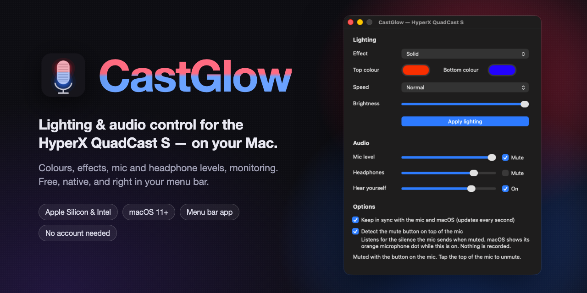
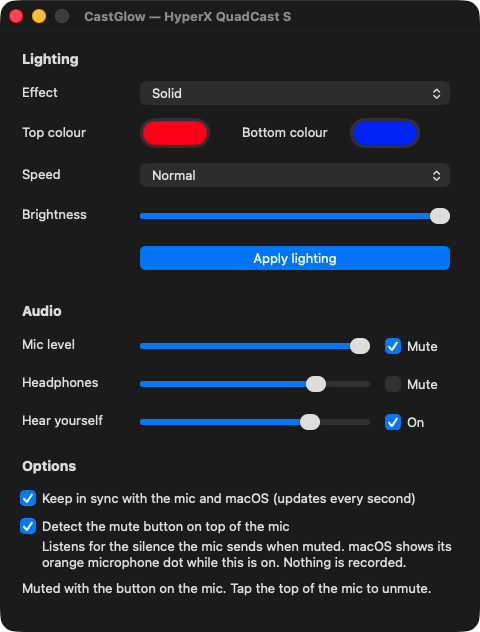

<p align="center">
  
</p>

<p align="center">
  <a href="https://github.com/chattydogmagazine/castglow/releases/latest/download/CastGlow-macOS.zip"><b>⬇️ Download CastGlow for Mac</b></a>
  &nbsp;·&nbsp; <a href="#install-in-5-steps-no-technical-knowledge-needed">How to install</a>
  &nbsp;·&nbsp; <a href="#questions--fixes">Help</a>
</p>

<p align="center">
  
  
  
  
</p>

---

## What is CastGlow?

**CastGlow is a small, free Mac app for the HyperX QuadCast S USB microphone.**
HyperX's own software (NGENUITY) only runs on Windows. CastGlow gives Mac owners the same everyday controls: the RGB lighting, your mic level, the headphone jack volume and "hear yourself" monitoring. It lives in your menu bar, so the controls are always one click away.

- 🎨 **Lighting.** Pick any colour for the top and bottom of the mic, or choose an effect: Solid, Blink, Breathing, Rainbow Cycle, Wave or Lightning. Set the speed and brightness.
- 💾 **Saved on the mic.** Lighting is stored inside the microphone, so it keeps glowing even when CastGlow is closed or the mic is plugged into another computer.
- 🎙️ **Audio.** Mic level, mic mute, headphone level, headphone mute, and monitoring (hear your own voice in the headphones) with its level.
- 🔄 **Always in step.** The window refreshes every second, so it shows changes made in macOS Sound settings or other apps too.
- 🔇 **Knows when you tap mute.** Optional: CastGlow can spot when you mute using the touch button on top of the mic, tick Mute and show a crossed-out mic in the menu bar.
- 🔝 **Menu bar.** A mic icon in the menu bar opens the settings, mutes the mic, or switches lights off or to rainbow in one click.
- 🪶 **Tiny.** The download is under 1 MB, there's no account or sign-in, and it collects no data. It needs no internet connection at all.

<p align="center">
  
</p>

## Install in 5 steps (no technical knowledge needed)

> You only do this once on each Mac. It works on most Macs from 2014 onwards running **macOS Big Sur (11) or newer**, with an Intel or Apple chip.

1. **Download.** Click **[Download CastGlow for Mac](https://github.com/chattydogmagazine/castglow/releases/latest/download/CastGlow-macOS.zip)**. A file called `CastGlow-macOS.zip` goes into your **Downloads** folder.
2. **Unzip.** Open your **Downloads** folder and double-click `CastGlow-macOS.zip`. The **CastGlow** app appears next to it.
3. **Move it to Applications.** Drag **CastGlow** onto **Applications** in the Finder sidebar. It now shows up in Launchpad and in Spotlight search (press `⌘ Space` and type *CastGlow*).
4. **Open it the first time.** Because CastGlow is free and not sold through the App Store, macOS asks you to confirm the first time you open it:
   - Double-click **CastGlow** in Applications. If you see *"CastGlow can't be opened"* or *"Apple could not verify…"*, click **Done** (or **OK**).
   - Open  **Apple menu → System Settings → Privacy & Security**, scroll down, and click **Open Anyway** next to the CastGlow message. Enter your Mac password if asked, then click **Open**.
   - *(On older macOS versions you can instead right-click CastGlow, choose **Open**, then **Open** again.)*
5. **Done.** The CastGlow window opens and a 🎙️ mic icon appears in your menu bar at the top of the screen.

Want CastGlow ready every time you turn on your Mac? Click the mic icon in the menu bar and tick **Start at Login**.

## Using CastGlow

| To… | Do this |
|---|---|
| Open the settings | Click the 🎙️ icon in the menu bar → **Open CastGlow…** (or open CastGlow from Launchpad) |
| Change the lighting | Choose an **Effect**, click the **Top** / **Bottom colour** boxes to pick colours, set **Speed** and **Brightness**, then click **Apply lighting** |
| Turn the lights off | Menu bar icon → **Lights Off**, or choose **Off** as the effect |
| Mute or unmute the mic | Menu bar icon → **Mute Mic**, or tick **Mute** in the window |
| Hear yourself in headphones | Tick **On** next to **Hear yourself** and adjust its slider |
| Keep the window up to date | Leave **Keep in sync** ticked under **Options** (on by default) |
| See when you've muted using the button on the mic | Tick **Detect the mute button on top of the mic** under **Options**, and click **Allow** if macOS asks about the microphone |
| Quit completely | Menu bar icon → **Quit CastGlow** (closing the window keeps it in the menu bar) |

## Questions & fixes

**I can't see the mic icon in the menu bar.**
Your menu bar may be full. macOS hides icons that don't fit, especially on smaller screens or MacBooks with a notch. On macOS Tahoe (26), open **System Settings → Menu Bar** and make sure **CastGlow** is allowed. Removing a few other menu bar icons also frees up space. You can always open CastGlow from Launchpad instead.

**It says "lighting controller not found".**
Check the QuadCast S is plugged in with its USB cable and that its lights are on. Try another USB port or cable, then reopen CastGlow.

**An audio slider is greyed out.**
That control isn't offered to macOS by your mic. Everything else still works.

**Does CastGlow know when I tap the top of the mic to mute?**
Only if you switch it on. The QuadCast S doesn't tell the computer when its touch button is pressed. While muted, though, it sends almost total silence: about 10 times quieter than even a silent room with the gain turned right down. With **Detect the mute button on top of the mic** ticked, CastGlow watches for that and shows the mute within about a second. The sound is checked in memory and immediately thrown away; nothing is recorded, saved or sent anywhere. macOS shows its orange microphone dot while this option is on, because CastGlow is listening. Untick the option to turn it off.

**Can CastGlow see the gain knob?**
No. The gain knob on the bottom of the mic works inside the mic and isn't reported to the computer. The **Mic level** slider in CastGlow is the separate macOS input level.

**Will this affect my Windows PC or NGENUITY?**
No. Lighting saved by CastGlow stays on the mic, and NGENUITY can change it again at any time.

**How do I uninstall?**
Quit CastGlow from its menu bar icon, then drag **CastGlow** from Applications to the Bin.

## Which microphones work?

| Microphone | Lighting | Audio controls |
|---|---|---|
| HyperX QuadCast S (USB IDs `03F0:0294` audio, `03F0:028C` lighting) | ✅ Tested | ✅ Tested |
| Other QuadCast S hardware revisions (lighting ID `03F0:098C`) | Should work, not yet tested | ✅ Should work |
| QuadCast 2 / QuadCast 2 S | ❌ Not supported yet | Partly (standard macOS audio controls) |

Polar pattern is set with the knob on the mic itself and isn't controlled by software.

## Windows

Windows users can already use HyperX NGENUITY. A lightweight CastGlow for Windows is planned. Watch this repository for updates.

## Build it yourself (for developers)

CastGlow is written in Rust with no runtime dependencies. It uses AppKit for the window and menu bar, CoreAudio for levels, and libusb for the lighting controller.

```sh
# Requires Xcode command line tools and Rust (https://rustup.rs)
rustup target add aarch64-apple-darwin x86_64-apple-darwin
./scripts/build-app.sh          # builds dist/CastGlow.app (universal) and dist/CastGlow-macOS.zip
```

There is also a command-line tool inside the app for scripting:

```sh
/Applications/CastGlow.app/Contents/MacOS/CastGlow status
/Applications/CastGlow.app/Contents/MacOS/CastGlow light solid red blue
/Applications/CastGlow.app/Contents/MacOS/CastGlow light effect breathing --colour purple --speed slow
/Applications/CastGlow.app/Contents/MacOS/CastGlow mic level 70
```

How the lighting protocol works is documented in [`src/protocol.rs`](src/protocol.rs). It was confirmed against real hardware, with protocol details cross-checked against the public notes of the [OpenRGB](https://gitlab.com/CalcProgrammer1/OpenRGB) project. No code from OpenRGB, QuadcastRGB or HyperX is included.

## Licence

CastGlow is **free to use, copy, change and share for any non-commercial purpose**. That covers personal use, hobby projects, education, charities and other non-profits. Selling it, bundling it into a paid product, or other commercial use is not allowed without permission.
See [LICENSE.md](LICENSE.md) (PolyForm Noncommercial 1.0.0) for the exact terms.

## Disclaimer

CastGlow is an **independent, unofficial project**. It is **not made, endorsed, supported or affiliated with HP Inc. or HyperX**. *HyperX*, *QuadCast* and *NGENUITY* are trademarks of HP Inc. and its affiliates; they're used here only to describe which hardware CastGlow works with. *Mac*, *macOS* and *Apple* are trademarks of Apple Inc.

CastGlow talks to your microphone using the same kind of USB commands as the official software. It's provided **"as is", without warranty of any kind**. You use it at your own risk, and the authors are not liable for any damage to hardware, loss of data, or any other issue arising from its use. Using unofficial software with your microphone may affect manufacturer support; check your warranty terms if that matters to you. See [DISCLAIMER.md](DISCLAIMER.md).
